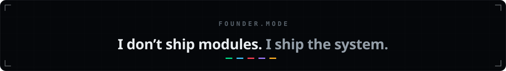
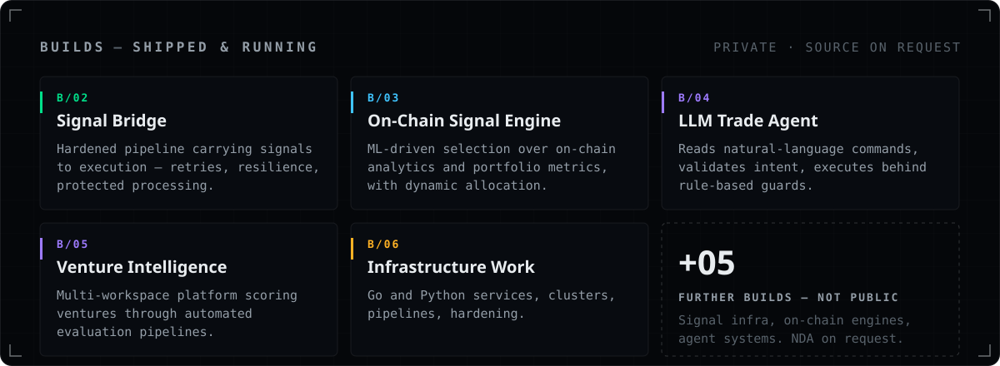
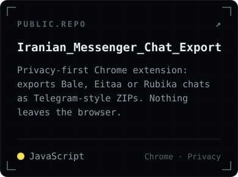

<!-- ah.sys :: profile — assets compiled by tools/build.py -->

 

 

  
  
  

 

  
  
  

<code>$ ah.sys --plain</code>

 

**Abolfazl Hosseini** — Systems Engineer & Technical Founder · Canada

I build systems that have to survive contact with the real world — live markets, open chains, hostile networks — and take them from the first architecture sketch to production traffic, alone if that's what it takes.

| Module | Focus |
| --- | --- |
| `QUANT.ENGINE` | HFT research, market microstructure, order-book dynamics, derivatives pricing, risk modeling, MQL5 |
| `CHAIN.SCAN` | On-chain analytics, probability & statistics, FRM, tail risk / VaR, portfolio metrics |
| `SEC.KERNEL` | Bug bounty, vulnerability research, OWASP, threat modeling, server hardening |
| `AGENT.MESH` | Agent orchestration, LangGraph, RAG, evaluation loops, LLM safety, React |
| `INFRA.BASE` | Go, Python, Kubernetes, AWS, Docker, Postgres, Redis |

**Builds** — [TradeVision](https://lhosseini.ir/tradevision.html) (MT5 execution terminal, live) · Signal Bridge · On-Chain Signal Engine · LLM Trade Agent · Venture Intelligence · five more under NDA.

**Contact** — [hosseini.systems@gmail.com](mailto:hosseini.systems@gmail.com) · [LinkedIn](https://www.linkedin.com/in/abhs) · [lhosseini.ir](https://lhosseini.ir)

